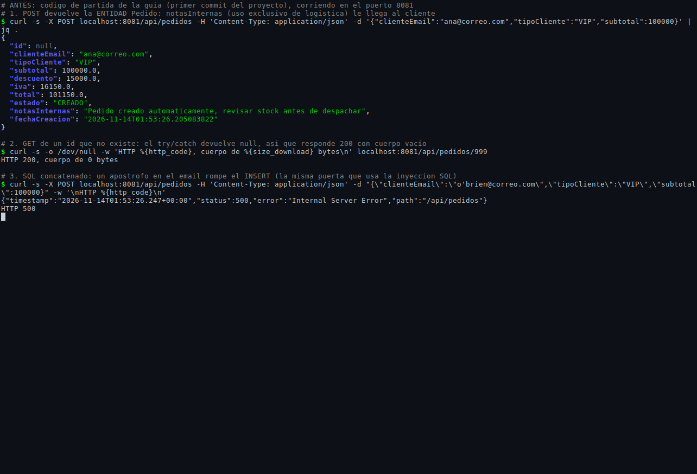
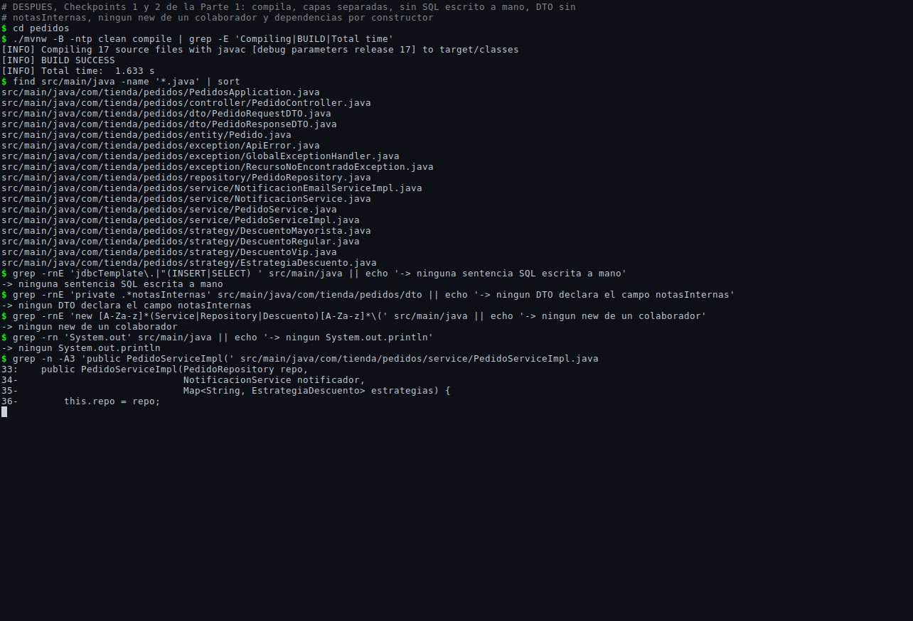
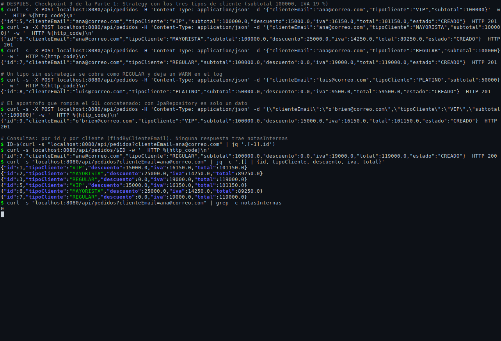
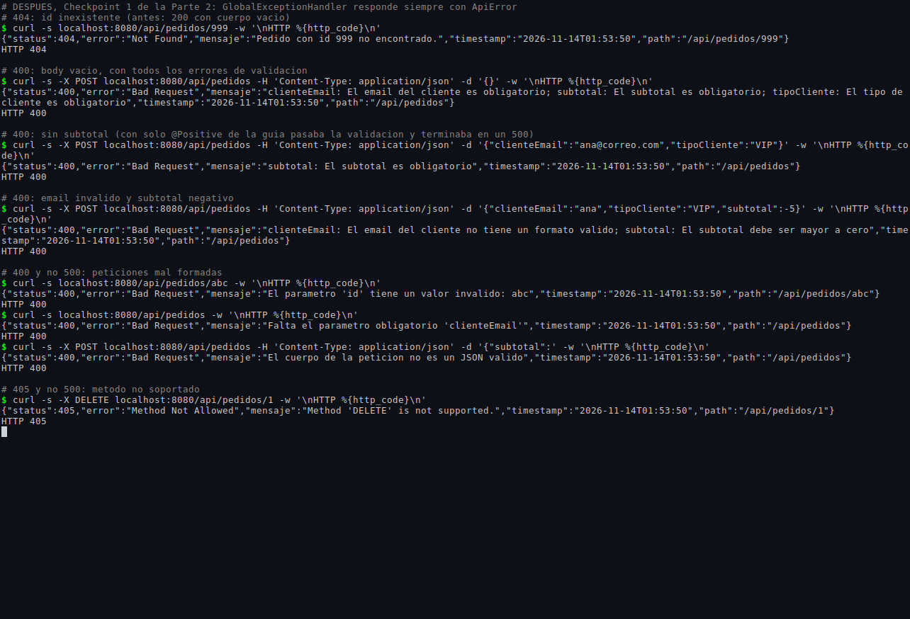
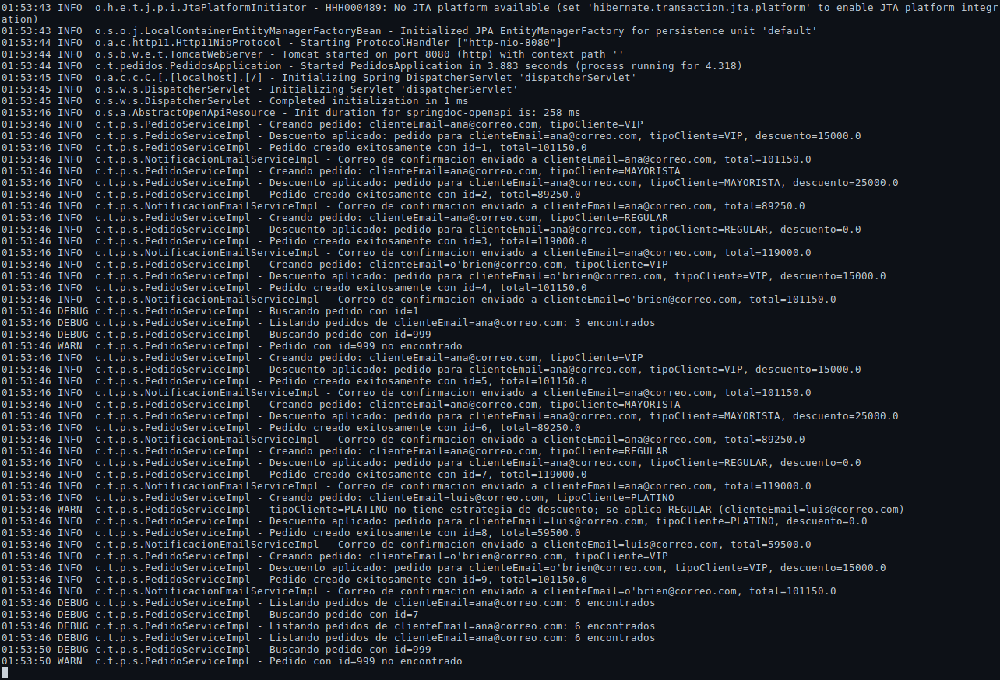
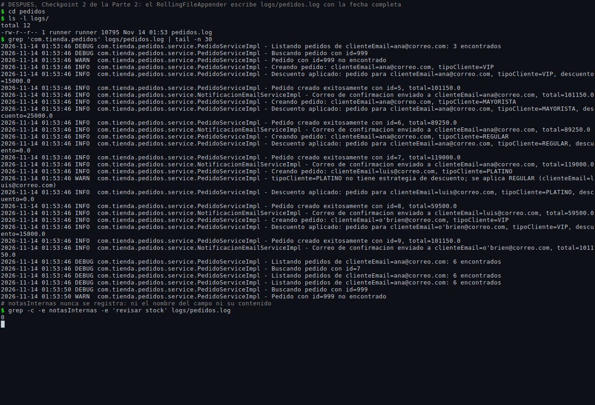
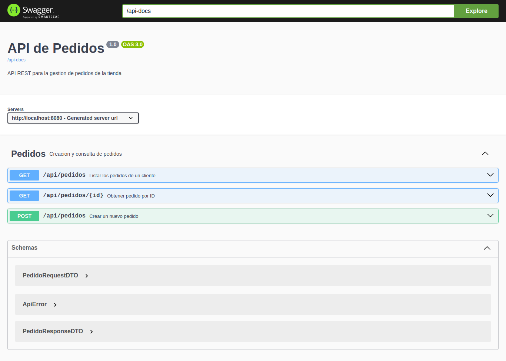
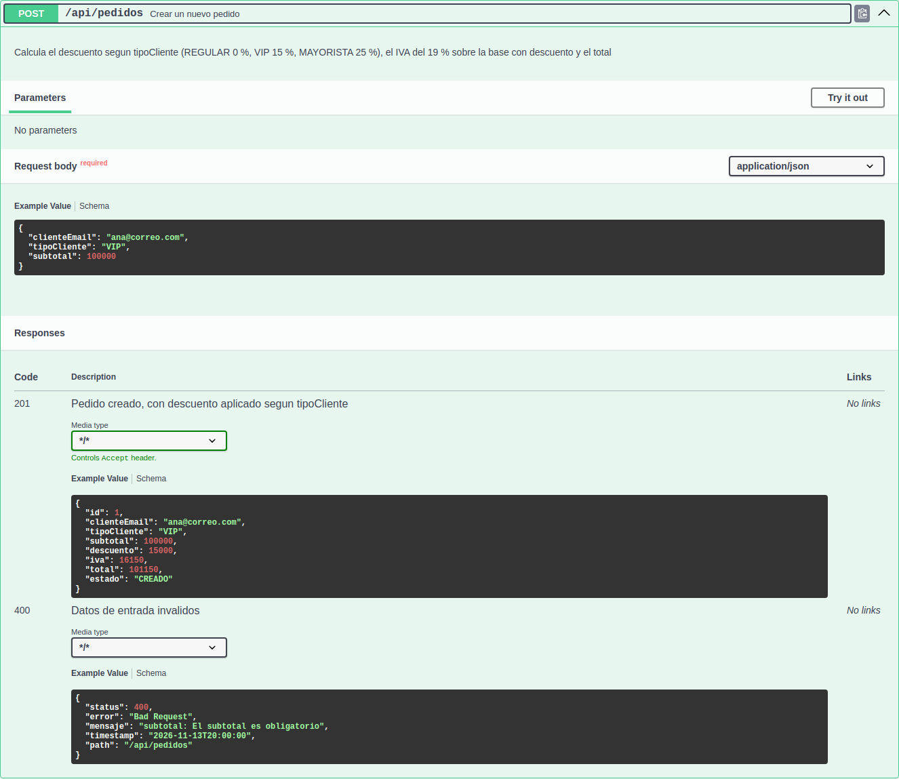
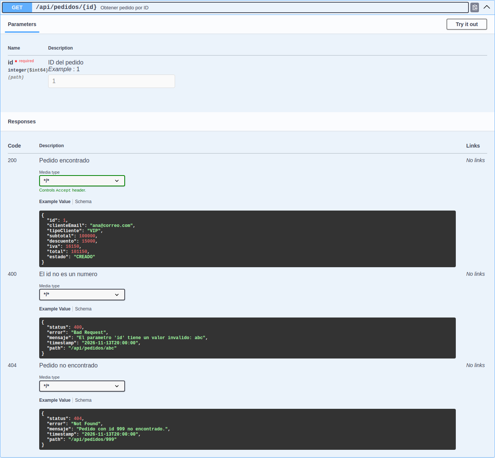
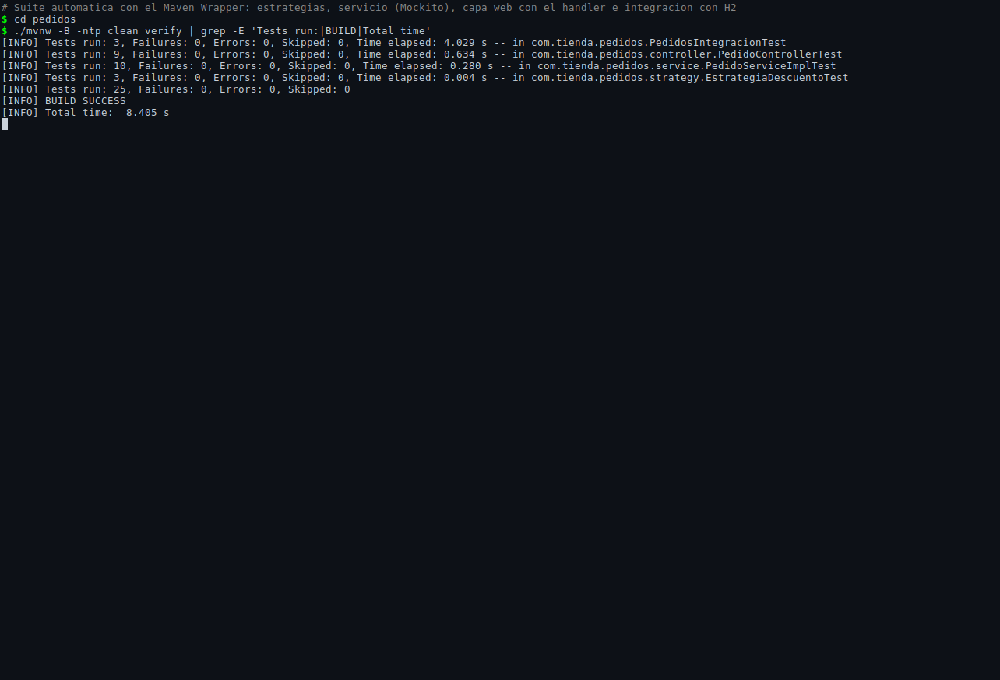

# Post-contenido, Unidad 11: Buenas Prácticas y Patrones de Diseño

**Estudiante:** Nicolás Andrés Sánchez Villamizar · Programación Web · Universidad de Santander (UDES)

## Descripción

Repositorio del laboratorio de la Unidad 11 de Programación Web. Tiene un único proyecto Maven Spring Boot ([`pedidos/`](pedidos)) que parte de un código con violaciones reales de SOLID (SRP y DIP), SQL embebido y la entidad JPA expuesta en la API.

**Parte 1.** Lo refactoricé aplicando:
- arquitectura en capas;
- el patrón DTO con mapeo explícito;
- inyección de dependencias por constructor;
- el patrón Strategy para el descuento por tipo de cliente.

**Parte 2.** Lo endurecí con:
- manejo centralizado de errores (`@RestControllerAdvice`);
- logging con SLF4J y Logback;
- documentación de la API con springdoc-openapi y Swagger.

El código de partida de la guía está en el primer commit del proyecto ([`3d5838c`](https://github.com/NicolasSnchz/sanchez-post1-u11-pweb/tree/3d5838c/pedidos/src/main/java/com/tienda/pedidos)), así que cada paso de la refactorización se puede ver en el historial.

Todo lo que muestra este README salió de ejecutar el proyecto de verdad en GitHub Actions, con el flujo [`pruebas.yml`](.github/workflows/pruebas.yml):
- el código de partida y la versión refactorizada corriendo al mismo tiempo;
- `curl` en terminales reales;
- Swagger UI abierto en Chromium.

Además hay **25 pruebas automáticas** en verde con JDK 17 y JDK 23.

## Arquitectura resultante

```
HTTP (JSON)
 │
 ▼
controller/PedidoController            solo traduce HTTP <-> servicio, @Valid sobre el DTO de entrada
 │   POST /api/pedidos
 │   GET  /api/pedidos/{id}
 │   GET  /api/pedidos?clienteEmail=
 │
 └─► service/PedidoService «interface»  (DIP: el controller no conoce la implementacion)
        ▲ implementa
     service/PedidoServiceImpl          orquesta; todas sus dependencias llegan por constructor
        ├─► repository/PedidoRepository «interface», extends JpaRepository<Pedido, Long>
        │      └── entity/Pedido (@Entity; guarda notasInternas, que nunca sale de la aplicacion)
        ├─► service/NotificacionService «interface»
        │      └── NotificacionEmailServiceImpl
        ├─► Map<String, EstrategiaDescuento>   strategy/, el nombre del bean es la llave
        │      ├── DescuentoRegular    @Component("REGULAR")     0 %
        │      ├── DescuentoVip        @Component("VIP")        15 %
        │      └── DescuentoMayorista  @Component("MAYORISTA")  25 %
        ├── recibe dto/PedidoRequestDTO y devuelve dto/PedidoResponseDTO (sin notasInternas)
        └── lanza exception/RecursoNoEncontradoException
                 │
                 ▼
exception/GlobalExceptionHandler (@RestControllerAdvice) ──► exception/ApiError  (400, 404, 405, 500)
```

Cada flecha va hacia una abstracción o hacia una capa de abajo. Ninguna clase de abajo conoce a la de arriba, y ninguna crea sus colaboradores con `new`.

## Violaciones del código de partida y cómo corregí cada una

Antes de refactorizar levanté el código de partida tal cual (puerto 8081) y comprobé tres de sus defectos con peticiones reales:

1. El POST devuelve la entidad con `notasInternas`.
2. Un id inexistente responde **200 con cuerpo vacío**.
3. Un apóstrofo en el correo (`o'brien@correo.com`) **rompe el INSERT** concatenado con un 500. Es la misma puerta que usa la inyección SQL.



| # | Violación en el código de partida | Cómo la corregí | Dónde |
|---|---|---|---|
| 1 | **SRP**: `crearPedido` validaba, calculaba el descuento, armaba el SQL, persistía, notificaba y registraba: seis responsabilidades en un método del controller | Cada responsabilidad en su lugar: validación declarativa en el DTO (`@Valid`), cálculo en las estrategias, persistencia en el repositorio, notificación en `NotificacionService` y orquestación en `PedidoServiceImpl`. El controller solo delega | [`PedidoController`](pedidos/src/main/java/com/tienda/pedidos/controller/PedidoController.java#L38-L48), [`PedidoServiceImpl.crear`](pedidos/src/main/java/com/tienda/pedidos/service/PedidoServiceImpl.java#L41-L56) |
| 2 | **DIP**: `new NotificacionEmailService()` dentro del controller, y `@Autowired` sobre un campo | `NotificacionService` es una interfaz. `PedidoServiceImpl` recibe repositorio, notificador y estrategias por constructor, y el controller recibe `PedidoService` (la interfaz) | [constructor](pedidos/src/main/java/com/tienda/pedidos/service/PedidoServiceImpl.java#L31-L39) |
| 3 | **Sin capa de datos**: SQL embebido y concatenado en el controller (`JdbcTemplate`), abierto a inyección SQL | `PedidoRepository extends JpaRepository`: `save`, `findById` y `findByClienteEmail` sin escribir SQL y siempre con parámetros | [`PedidoRepository`](pedidos/src/main/java/com/tienda/pedidos/repository/PedidoRepository.java) |
| 4 | **Entidad expuesta**: la API devolvía `Pedido` completo, con `notasInternas` | `PedidoRequestDTO` (entrada, con Bean Validation) y `PedidoResponseDTO` (salida, sin `notasInternas`) con mapeo explícito en [`toResponseDTO`](pedidos/src/main/java/com/tienda/pedidos/service/PedidoServiceImpl.java#L111-L123) | [`dto/`](pedidos/src/main/java/com/tienda/pedidos/dto) |
| 5 | **OCP** (implícito en el `if/else`): cada tipo de cliente nuevo obligaba a editar el método | Patrón Strategy: un tipo nuevo es una clase nueva con `@Component("NOMBRE")`, sin tocar el servicio | [`strategy/`](pedidos/src/main/java/com/tienda/pedidos/strategy), [selección](pedidos/src/main/java/com/tienda/pedidos/service/PedidoServiceImpl.java#L50-L51) |
| 6 | **Errores dispersos**: `try/catch` que imprimía con `println` y devolvía `null` (200 vacío) | `RecursoNoEncontradoException` en el servicio y `GlobalExceptionHandler` que responde `ApiError` con 404, 400 o 500. Ningún `try/catch` en el controller | [`GlobalExceptionHandler`](pedidos/src/main/java/com/tienda/pedidos/exception/GlobalExceptionHandler.java) |
| 7 | **Logging con `System.out.println`** | SLF4J con placeholders `{}` y niveles; `logback-spring.xml` con consola y archivo rotativo | [logs del servicio](pedidos/src/main/java/com/tienda/pedidos/service/PedidoServiceImpl.java#L43-L54) |

## Parte 1: Refactorización con SOLID, DTO y Strategy

**Checkpoints 1 y 2: DTO, `PedidoRepository` y servicio con DIP.** En la captura:

- `mvn clean compile` termina en `BUILD SUCCESS`.
- Los archivos quedan organizados por capa.
- No queda ninguna sentencia SQL escrita a mano, ningún `new` de un colaborador ni ningún `System.out.println`.
- Los DTO no declaran `notasInternas`.
- El constructor de `PedidoServiceImpl` recibe sus tres dependencias.



**Checkpoint 3: Strategy con los tres tipos de cliente.** Subtotal 100000 e IVA del 19 % sobre la base con descuento:

| tipoCliente | Estrategia | descuento | iva | total |
|---|---|---|---|---|
| VIP | `DescuentoVip` (15 %) | 15000.0 | 16150.0 | 101150.0 |
| MAYORISTA | `DescuentoMayorista` (25 %) | 25000.0 | 14250.0 | 89250.0 |
| REGULAR | `DescuentoRegular` (0 %) | 0.0 | 19000.0 | 119000.0 |

Los tres responden 201 y ninguna respuesta trae `notasInternas`, ni al crear ni al consultar. La captura también muestra:

- Un tipo sin estrategia (`PLATINO`) se cobra como REGULAR y deja un WARN en el log.
- El correo con apóstrofo, que rompía el código de partida, ahora es solo un dato más.
- Las consultas por id y por cliente funcionan.



## Parte 2: Manejo de errores, logging y documentación

### Checkpoint 1: `GlobalExceptionHandler` con `@RestControllerAdvice`

Toda excepción termina en [`GlobalExceptionHandler`](pedidos/src/main/java/com/tienda/pedidos/exception/GlobalExceptionHandler.java) y sale como [`ApiError`](pedidos/src/main/java/com/tienda/pedidos/exception/ApiError.java) (`status`, `error`, `mensaje`, `timestamp`, `path`):

| Situación | Handler | Respuesta |
|---|---|---|
| Id inexistente | `RecursoNoEncontradoException` | **404** `"Pedido con id 999 no encontrado."` (antes: 200 vacío) |
| Body inválido (`{}`, sin subtotal, email mal escrito, subtotal negativo) | `MethodArgumentNotValidException` | **400** con todos los errores de validación |
| JSON mal formado, id no numérico (`/abc`), falta `clienteEmail` | `handleSolicitudMalFormada` | **400** con un mensaje claro |
| Ruta o método no soportado | `handleGeneral`, que respeta el código de Spring | **404 / 405** |
| Cualquier otro error | `Exception` | **500** `"Error inesperado. Contactar soporte."`, y la traza completa solo en el log (ERROR) |



### Checkpoint 2: SLF4J y Logback

`PedidoServiceImpl` usa `LoggerFactory.getLogger` con placeholders `{}`:

| Nivel | Eventos |
|---|---|
| **INFO** | Creación, descuento aplicado y pedido guardado con su id |
| **DEBUG** | Búsquedas (el logger `com.tienda.pedidos` está en DEBUG) |
| **WARN** | Pedido no encontrado, tipo de cliente sin estrategia |
| **ERROR** | Falla del envío de la confirmación ([líneas 95 a 101](pedidos/src/main/java/com/tienda/pedidos/service/PedidoServiceImpl.java#L95-L101)) y error inesperado en el handler |

[`logback-spring.xml`](pedidos/src/main/resources/logback-spring.xml) tiene dos appenders:

- `CONSOLA` con el patrón corto `HH:mm:ss NIVEL logger - mensaje`;
- `ARCHIVO`, un `RollingFileAppender` que escribe en `logs/pedidos.log` con fecha completa, rotación diaria (`pedidos.%d{yyyy-MM-dd}.log`) y 30 días de historial.

`logs/` está en el [`.gitignore`](pedidos/.gitignore).

La consola es la de la aplicación corriendo en primer plano en una terminal, mientras las otras terminales le hacían las peticiones:



El archivo, con el mismo contenido en formato de fecha completo. El último comando cuenta las líneas que mencionan `notasInternas` o su contenido ("revisar stock"): **0**.



### Checkpoint 3: springdoc-openapi y Swagger UI

Anotaciones usadas:

- `@OpenAPIDefinition` en [`PedidosApplication`](pedidos/src/main/java/com/tienda/pedidos/PedidosApplication.java);
- `@Tag`, `@Operation`, `@ApiResponse` y `@Parameter` en el [controller](pedidos/src/main/java/com/tienda/pedidos/controller/PedidoController.java);
- `@Schema` con descripciones en español y ejemplos en los dos DTO y en `ApiError`.

Cada respuesta de error declara su cuerpo `ApiError` con un ejemplo propio (el 400 de validación, el 400 de un id no numérico, el 404). Swagger UI (`/swagger-ui.html`) muestra el grupo "Pedidos" con los **3 endpoints**:



POST expandido: descripción del cálculo, cuerpo de ejemplo y respuestas 201 y 400, cada una con su ejemplo:



GET por id: parámetro con ejemplo y respuestas 200, 400 y 404:



## Decisiones de diseño

**Parte 1**

1. **JpaRepository en vez de mantener JdbcTemplate.** El SQL concatenado exponía el proyecto a inyección SQL y obligaba a mantener las sentencias sincronizadas con la entidad a mano. Con Spring Data JPA los métodos CRUD y las consultas derivadas (`findByClienteEmail`) salen del nombre del método, siempre con parámetros y con tipos revisados al compilar. La captura del apóstrofo lo muestra en vivo.
2. **Strategy para el descuento y no un segundo patrón (Factory/Mapper) para el DTO.** El descuento tiene variación real de comportamiento y va a crecer: un tipo CORPORATIVO futuro es una clase nueva con `@Component("CORPORATIVO")` y no toca `PedidoServiceImpl` (OCP). La conversión entidad-DTO es un mapeo 1:1 sin lógica condicional, así que la resuelve un método privado, [`toResponseDTO`](pedidos/src/main/java/com/tienda/pedidos/service/PedidoServiceImpl.java#L111-L123), sin una clase más que sería sobreingeniería.
3. **`Map<String, EstrategiaDescuento>` con el nombre del bean como llave.** Spring arma el mapa solo. Elegir la estrategia es una búsqueda, no un `switch`, y la prueba [`contexto_registraLasTresEstrategias...`](pedidos/src/test/java/com/tienda/pedidos/PedidosIntegracionTest.java) comprueba las tres llaves.
4. **Un tercer endpoint, `GET /api/pedidos?clienteEmail=`.** La guía define `findByClienteEmail` en el repositorio pero ningún código lo usa, y la rúbrica pide documentar al menos 3 endpoints. El endpoint le da uso a esa consulta y completa los tres.
5. **Montos redondeados a dos decimales** con `BigDecimal` y `HALF_UP` ([`redondear`](pedidos/src/main/java/com/tienda/pedidos/service/PedidoServiceImpl.java#L105-L109)). Con `double`, los valores de la guía salen exactos, pero un subtotal como 123456.78 daría un total de 124876.53297. La prueba [`crear_subtotalConCentavos_redondeaLosMontosADosDecimales`](pedidos/src/test/java/com/tienda/pedidos/service/PedidoServiceImplTest.java) lo cubre.

**Parte 2**

6. **El registro del descuento vive en el servicio y no en cada Strategy.** Un solo `log.info("Descuento aplicado: ...")` justo después de invocar la estrategia ([línea 53](pedidos/src/main/java/com/tienda/pedidos/service/PedidoServiceImpl.java#L53-L54)) es un único punto de auditoría por pedido. Así el rastro no se dispersa en tres clases.
7. **`notasInternas` nunca se registra en los logs ni se expone en el DTO.** Es información operativa de logística, y un archivo de log se comparte con soporte y queda retenido 30 días. Los mensajes solo llevan identificadores (id, clienteEmail, tipoCliente) y montos. El archivo real tiene 0 líneas con ese campo.
8. **Los errores del cliente responden 400, no 500, y los de Spring conservan su código.** El handler genérico de la guía convertiría un JSON mal formado, `/api/pedidos/abc` o un DELETE en un 500 "Error inesperado", culpando al servidor de un error del cliente. Agregué un handler 400 para peticiones mal formadas. Para las excepciones propias de Spring (`ErrorResponse`) se respeta su código (404, 405). El 500 queda solo para errores reales, registrados con ERROR y la traza.
9. **Si falla el correo de confirmación, el pedido no se pierde.** El pedido ya está guardado cuando se notifica, así que una falla del notificador se registra con ERROR y la respuesta sigue siendo 201. Es el único `try/catch` del proyecto, y está en el servicio, no disperso en el controller. Lo cubre [`crear_siFallaLaNotificacion_igualDevuelveElPedidoGuardado`](pedidos/src/test/java/com/tienda/pedidos/service/PedidoServiceImplTest.java).
10. **`springdoc.override-with-generic-response=false`.** Sin esta propiedad, springdoc agrega a todos los endpoints las respuestas del `@RestControllerAdvice`, y por ejemplo el POST mostraría un 404 que nunca ocurre. Así cada endpoint documenta solo sus respuestas reales.

## Pruebas automáticas

25 pruebas, en verde con JDK 17 y con JDK 23:

| Clase | Pruebas | Qué cubre |
|---|---|---|
| [`EstrategiaDescuentoTest`](pedidos/src/test/java/com/tienda/pedidos/strategy/EstrategiaDescuentoTest.java) | 3 | Cada estrategia por separado (0 %, 15 %, 25 %) |
| [`PedidoServiceImplTest`](pedidos/src/test/java/com/tienda/pedidos/service/PedidoServiceImplTest.java) | 10 | Con Mockito (posible gracias a DIP): los tres tipos y minúsculas (parametrizada), tipo sin estrategia, redondeo, `notasInternas` guardado pero fuera del DTO, falla del correo, 404 del servicio, listado |
| [`PedidoControllerTest`](pedidos/src/test/java/com/tienda/pedidos/controller/PedidoControllerTest.java) | 9 | `@WebMvcTest` con el handler real: 201 sin `notasInternas`, 400 por validación, JSON mal formado, id no numérico y parámetro faltante, 404, 405 y 500 sin filtrar detalles internos |
| [`PedidosIntegracionTest`](pedidos/src/test/java/com/tienda/pedidos/PedidosIntegracionTest.java) | 3 | Aplicación completa con H2: el `Map` de estrategias, el recorrido POST → GET con `notasInternas` guardado en la base pero nunca en la respuesta, y el 404 |



## Inconsistencias del enunciado y cómo las resolví

| # | En la guía | Problema | Cómo lo resolví |
|---|---|---|---|
| 1 | `PedidoRequestDTO` con solo `@Positive` en `subtotal` | `@Positive` considera válido un `null`: un pedido sin subtotal pasa la validación y el servicio falla con un `NullPointerException` (500) | `@NotNull` además de `@Positive`, y `@Email` en `clienteEmail` |
| 2 | La rúbrica pide documentar "al menos los 3 endpoints" | La guía solo define 2 (POST y GET por id) | Tercer endpoint `GET /api/pedidos?clienteEmail=`, que además usa `findByClienteEmail` |
| 3 | `NotificacionEmailServiceImpl` con `System.out.println` | La rúbrica (Excelente) pide "sin ningún System.out.println remanente" | Logger SLF4J también en el notificador |
| 4 | Checkpoint 2: "el proyecto ya compila con las interfaces definidas" | El `PedidoServiceImpl` que muestra la guía recibe el `Map` de estrategias del Checkpoint 3: sin el paquete `strategy`, no compila | En el commit del servicio el cálculo todavía es el `if/else` movido desde el controller; el commit siguiente lo cambia por Strategy. Cada commit compila |
| 5 | Commit 2 ("eliminar SQL embebido") con `git add` de `entity`, `dto` y `repository` solamente | El SQL estaba en el controller, que no entra en ese commit; además mover `Pedido` a `entity/` rompe su import | El commit 2 también actualiza el controller: usa el repositorio y los DTO, sin SQL |
| 6 | El commit de Strategy agrega solo `strategy/` | El servicio debe empezar a usar el `Map` | El commit incluye el cambio en `PedidoServiceImpl` |
| 7 | El código de partida "ya viene escrito" pero ningún `git add` lo incluye | Sin él, el historial no muestra qué se refactorizó | El primer commit es el proyecto de partida tal cual, en un solo paquete |
| 8 | `handleGeneral(Exception)` con `@ResponseStatus(500)` | Atrapa también las excepciones de Spring MVC: un JSON mal formado, `/abc` o un método no soportado saldrían como 500 | Decisión 8 |
| 9 | Niveles INFO/WARN/ERROR en el servicio | El servicio de la guía no tiene ningún evento de nivel ERROR | ERROR en la falla del correo (decisión 9) y en el error inesperado del handler, con la traza |
| 10 | Spring Boot 3.2 con su `maven-compiler-plugin` 3.11.0 | Falla al compilar con JDK 23 | `maven-compiler-plugin` 3.13.0 en el [`pom.xml`](pedidos/pom.xml) |
| 11 | `./mvnw spring-boot:run` | Los `git add` de la guía nunca versionan el Maven Wrapper | Está en el primer commit |
| 12 | Repositorio `apellido-post1-u11` | | `sanchez-post1-u11-pweb`, con el sufijo que uso para distinguir las materias |

## Cómo compilar y ejecutar

1. Clonar el repositorio: `git clone https://github.com/NicolasSnchz/sanchez-post1-u11-pweb.git`
2. Dentro de `pedidos/`, ejecutar `./mvnw spring-boot:run` (en Windows, `mvnw.cmd spring-boot:run`). Usa H2 en memoria y no necesita instalar nada más.
3. Probar los endpoints en `http://localhost:8080/api/pedidos`, por ejemplo:
   ```
   curl -X POST localhost:8080/api/pedidos -H "Content-Type: application/json" -d "{\"clienteEmail\":\"ana@correo.com\",\"tipoCliente\":\"VIP\",\"subtotal\":100000}"
   ```
4. Revisar los logs en la consola y en `pedidos/logs/pedidos.log`.
5. Abrir la documentación interactiva en `http://localhost:8080/swagger-ui.html` (el JSON de OpenAPI está en `/api-docs`).
6. Pruebas: `./mvnw clean verify`.

## Historial de commits

**Parte 1**

1. `feat: proyecto Spring Boot de partida con H2 y validation (parte 1)`: el código de la guía, sin tocar.
2. `refactor: extraer PedidoRequestDTO/ResponseDTO y PedidoRepository, eliminar SQL embebido (parte 1)`
3. `refactor: PedidoService con inyeccion por constructor (DIP), controller delega en el servicio (parte 1)`
4. `feat: patron Strategy para el calculo del descuento por tipo de cliente (parte 1)`

**Parte 2**

5. `feat: dependencia springdoc-openapi y configuracion de Swagger UI (parte 2)`
6. `feat: GlobalExceptionHandler con @RestControllerAdvice, reemplaza try/catch disperso (parte 2)`
7. `feat: logger SLF4J en PedidoServiceImpl y logback-spring.xml con RollingFileAppender (parte 2)`
8. `docs: anotaciones de springdoc-openapi en controlador y DTO (parte 2)`
9. `test: ...`: las pruebas automáticas.

Después vienen el flujo de GitHub Actions (`ci:`), este README con las capturas, y un ajuste para que cada respuesta de error tenga su propio ejemplo en Swagger. Ese ajuste cambió el código, así que el flujo volvió a generar las capturas y el README.

Cada commit compila y pasa sus propias pruebas por sí solo; lo verifiqué commit por commit en el mismo flujo.

## Cómo se generaron las capturas

El job `evidencias` de [`pruebas.yml`](.github/workflows/pruebas.yml) corre cuando no hay capturas o cuando el código de `pedidos/src` cambió desde las últimas, así que las capturas siempre corresponden al código del repositorio. Usa los scripts de [`.github/evidencias/`](.github/evidencias):

1. Compiló y probó cada commit.
2. Corrió la suite con JDK 17 y JDK 23.
3. Levantó el código de partida en el puerto 8081 y la versión refactorizada en el 8080; esta última, en primer plano dentro de una terminal, que es la captura de la consola.
4. Hizo las peticiones con `curl` en terminales reales.
5. Abrió Swagger UI en Chromium.
6. Escribió este README solo si todas las respuestas, los montos, los logs y el OpenAPI dieron lo esperado.

Las capturas de terminal son ventanas reales, no texto pegado.
